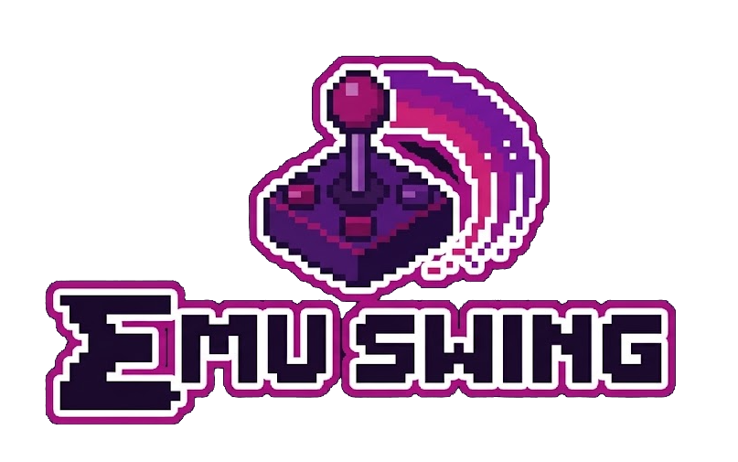

# EmuSwing

EmuSwing es un proyecto desarrollado en Java que busca ofrecer una plataforma de videojuegos clásicos y arcade, con una interfaz sencilla y accesible. La propuesta contempla un catálogo de juegos, una biblioteca personal y funcionalidades orientadas a la experiencia del usuario.

El proyecto se encuentra en desarrollo y utiliza Java Swing para la interfaz gráfica, con una arquitectura organizada en módulos.

> **Estado actual: versión beta.** La aplicación fue ejecutada en Linux y Windows 11 desde Eclipse. Algunas funcionalidades todavía pueden estar en desarrollo.

## Índice

- [¿Qué buscamos?](#qué-buscamos)
- [Tecnologías](#tecnologías)
- [Arquitectura y estructura](#arquitectura-y-estructura)
- [Ejecución en Eclipse](#ejecución-en-eclipse)
  - [Requisitos previos](#1-requisitos-previos)
  - [Clonar el repositorio](#2-clonar-el-repositorio)
  - [Configurar Java 8](#3-configurar-java-8-en-eclipse)
  - [Importar los módulos](#4-importar-y-configurar-los-módulos)
  - [Configurar Maven y JCEF](#5-importar-frontend-como-proyecto-maven-y-configurar-jcef)
  - [Limpiar y compilar](#6-limpiar-y-compilar)
  - [Ejecutar la aplicación](#7-ejecutar-emuswing)
- [Solución de problemas](#solución-de-problemas)
- [Estado del proyecto](#estado-del-proyecto)

## ¿Qué buscamos?

El objetivo de EmuSwing es ofrecer una experiencia sencilla para acceder a videojuegos clásicos desde una misma aplicación.

Entre los objetivos del proyecto se encuentran:

- Organizar un catálogo de juegos y una biblioteca personal.
- Ofrecer una interfaz gráfica intuitiva.
- Incorporar funcionalidades de perfil, avatares y seguimiento del usuario.
- Integrar la ejecución de juegos compatibles dentro de la aplicación.
- Mantener una estructura modular que facilite el desarrollo y el trabajo colaborativo.

## Tecnologías

- **Java 8:** lenguaje y versión de compatibilidad del proyecto.
- **Java Swing:** desarrollo de la interfaz gráfica.
- **Eclipse IDE:** entorno de desarrollo.
- **Maven:** gestión de dependencias del módulo `FRONTEND`.
- **JCEF (Java Chromium Embedded Framework):** integración del navegador Chromium para ejecutar juegos compatibles dentro de la interfaz.
- **Git y GitHub:** control de versiones y trabajo colaborativo.

## Arquitectura y estructura

El proyecto se organiza en cuatro módulos principales:

| Módulo | Responsabilidad |
|---|---|
| `ENTITIES` | Entidades y modelos del dominio. |
| `COMMONS` | Clases y componentes compartidos, como excepciones y helpers. |
| `BACKEND` | API, lógica de acceso y DTO. |
| `FRONTEND` | Interfaz gráfica Swing y funcionalidades de interacción con el usuario. |

La estructura general del repositorio es la siguiente:

```text
EmuSwing/
├── BACKEND/
│   └── src/
├── COMMONS/
│   └── src/
├── ENTITIES/
│   └── src/
├── FRONTEND/
│   ├── pom.xml
│   └── src/
├── LICENSE
└── README.md
```

Cada módulo contiene su código fuente dentro de `src`. El módulo `FRONTEND` utiliza Maven para gestionar las dependencias externas necesarias para ejecutar la aplicación.

## Ejecución en Eclipse

Esta guía describe cómo preparar y ejecutar la versión beta de EmuSwing desde Eclipse en **Linux y Windows 11**.

### 1. Requisitos previos

Antes de comenzar, necesitás:

- Eclipse IDE for Java Developers.
- Un JDK 8 instalado.
- Git.
- Conexión a Internet para descargar las dependencias Maven y los componentes de JCEF.

El proyecto debe configurarse para Java 8 tanto al compilar como al ejecutar. **No alcanza con seleccionar compatibilidad 1.8 si Eclipse termina ejecutando la aplicación con un JDK más nuevo.**

### 2. Clonar el repositorio

Abrí una terminal y ejecutá:

```bash
git clone https://github.com/snsanchez/EmuSwing.git
cd EmuSwing
```

Si la versión beta todavía no está disponible en la rama principal, cambiá a la rama que contenga los cambios integrados y funcionales antes de continuar.

### 3. Configurar Java 8 en Eclipse

#### 3.1. Registrar el JDK

En Eclipse, ingresá a:

`Window > Preferences > Java > Installed JREs`

1. Seleccioná `Add...`.
2. Elegí `Standard VM`.
3. Indicá la ruta de instalación del JDK 8.
4. Finalizá y verificá que Eclipse reconozca la instalación.

En Linux, seleccioná el directorio del JDK 8 instalado. En Windows, indicá la carpeta correspondiente a la instalación de Java 8.

#### 3.2. Configurar los proyectos

Para cada módulo (`BACKEND`, `COMMONS`, `ENTITIES` y `FRONTEND`), ingresá a:

`Click derecho sobre el proyecto > Properties > Java Compiler`

Activá la configuración específica del proyecto y seleccioná el nivel de compatibilidad **1.8**.

Después, en:

`Properties > Java Build Path > Libraries`

Verificá que `JRE System Library` esté configurada como `JavaSE-1.8` y asociada a una instalación real de Java 8.

### 4. Importar y configurar los módulos

#### 4.1. Importar los proyectos existentes

En Eclipse, seleccioná:

`File > Import... > General > Existing Projects into Workspace`

Elegí la carpeta del repositorio e importá los proyectos que Eclipse detecte.

Algunos módulos pueden no aparecer automáticamente porque sus archivos de configuración locales de Eclipse (`.project`, `.classpath` y `.settings`) no necesariamente están incluidos en el repositorio.

Si un módulo no aparece:

1. Creá un proyecto Java local para ese módulo.
2. Utilizá la carpeta existente del módulo como ubicación del proyecto.
3. Configurá `src` como carpeta de código fuente.
4. No muevas los archivos ni crees una segunda estructura de carpetas.

Repetí el procedimiento hasta tener disponibles los cuatro módulos.

#### 4.2. Configurar las dependencias entre proyectos

En cada módulo, ingresá a:

`Properties > Java Build Path > Projects`

Configurá las siguientes dependencias internas:

- `FRONTEND` → `BACKEND`, `ENTITIES` y `COMMONS`.
- `BACKEND` → `ENTITIES` y `COMMONS`.
- `ENTITIES` → `COMMONS`.
- `COMMONS` → ninguna dependencia interna.

Esto permite que Eclipse encuentre las clases de los demás módulos durante la compilación.

### 5. Importar FRONTEND como proyecto Maven y configurar JCEF

El módulo `FRONTEND` contiene el archivo `pom.xml`, donde se declaran las dependencias externas necesarias para la aplicación.

#### 5.1. Importar el proyecto Maven

En Eclipse:

1. Seleccioná `File > Import...`.
2. Elegí `Maven > Existing Maven Projects`.
3. Indicá la carpeta `FRONTEND` del repositorio.
4. Verificá que Eclipse detecte el archivo `pom.xml`.
5. Finalizá la importación y esperá a que Maven descargue las dependencias.

Si no aparece la opción de Maven, verificá que esté instalado el soporte Maven de Eclipse, conocido como **m2e**.

#### 5.2. Preparar JCEF

JCEF permite integrar un navegador basado en Chromium dentro de una ventana Swing para ejecutar juegos compatibles.

Durante la primera ejecución, JCEF puede descargar y preparar los componentes nativos que necesita. Este proceso requiere conexión a Internet y puede tardar más que las siguientes ejecuciones.

**Importante:**

- Cada sistema operativo debe utilizar sus propios componentes nativos.
- No copies el directorio `jcef-bundle` de Linux a Windows ni al revés.
- No subas `jcef-bundle` al repositorio Git: contiene componentes generados o descargados que dependen de la plataforma.
- Si la descarga no termina correctamente, revisá la conexión a Internet y los errores que aparezcan en la consola de Eclipse.

### 6. Limpiar y compilar

En Eclipse, seleccioná:

`Project > Clean...`

Limpiá los proyectos y esperá a que finalice la compilación automática.

Antes de ejecutar, verificá que:

- Los cuatro módulos tengan compatibilidad Java 8.
- Las dependencias entre proyectos estén configuradas.
- Maven haya resuelto las dependencias de `FRONTEND`.
- No queden errores de compilación.

### 7. Ejecutar EmuSwing

En el módulo `FRONTEND`, buscá la clase principal:

`src/ar/edu/unrn/seminario/main/Main.java`

Hacé clic derecho sobre `Main.java` y seleccioná:

`Run As > Java Application`

La ventana principal de EmuSwing debería abrirse. Desde la interfaz, navegá hasta la funcionalidad de carga de juegos para probar la integración con JCEF.

#### Diferencias entre Linux y Windows

La configuración de JCEF contempla diferencias en el renderizado gráfico entre sistemas operativos. La configuración correspondiente se encuentra en el código de la aplicación, por lo que no debería ser necesario modificarla manualmente para seguir estos pasos.

La ejecución fue probada en Linux y Windows 11. Esto confirma la compatibilidad de la configuración probada en esos entornos, pero no garantiza el funcionamiento en todas las distribuciones, versiones de Windows o configuraciones de hardware.

## Solución de problemas

### Eclipse informa errores de versión de Java

Revisá `Java Compiler` y `Java Build Path > Libraries` en los cuatro módulos. Todos deben estar configurados para Java 8 y utilizar una instalación real de JDK 8.

### No se encuentran clases de otros módulos

Verificá que los cuatro proyectos estén importados y que las dependencias de `Java Build Path > Projects` coincidan con las indicadas en esta guía.

### Maven no descarga las dependencias

Comprobá la conexión a Internet y que `FRONTEND` esté importado como proyecto Maven. También podés hacer clic derecho sobre el proyecto y seleccionar:

`Maven > Update Project...`

### JCEF muestra una ventana negra o un error gráfico

Comprobá que la descarga de JCEF haya finalizado y que se estén utilizando los componentes correspondientes al sistema operativo. Si el error persiste, guardá el mensaje completo de la consola de Eclipse, junto con el sistema operativo y la versión de Java utilizados.

### La aplicación funciona en Linux, pero no en Windows, o viceversa

No reutilices el `jcef-bundle` de otra plataforma. Verificá también la arquitectura del sistema, el JDK 8 y los controladores gráficos.

## Estado del proyecto

EmuSwing se encuentra en desarrollo. Esta versión beta está orientada a realizar pruebas de las funcionalidades implementadas y facilitar la integración entre los distintos módulos.

La guía cubre la ejecución desde Eclipse; no describe la generación de un instalador independiente.

Las dependencias y los componentes nativos de JCEF pueden requerir descargas durante la primera ejecución. La disponibilidad de los juegos depende también de las URL utilizadas y del funcionamiento de los servicios externos.

Los errores encontrados durante las pruebas pueden reportarse al equipo para facilitar su diagnóstico y corrección en futuras versiones.
