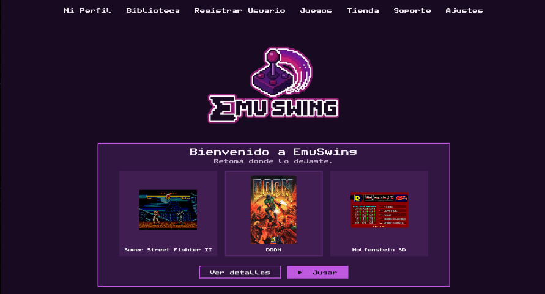
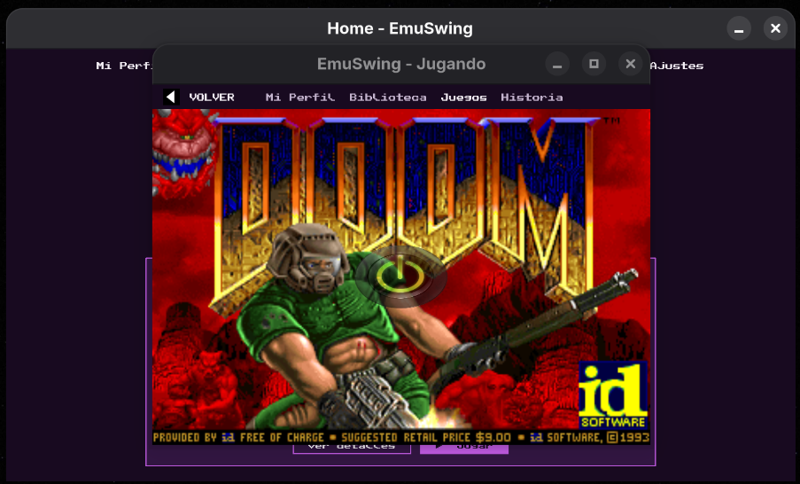

[](https://youtu.be/f-X12u-gGX0)

<video src="https://github.com/user-attachments/assets/4f33efa2-5e75-4c8d-b4d1-214ccab7e475" width="100%" controls autoplay muted loop playsinline>
</video>


## Capturas de pantalla

### Pantalla principal



### Juego DOOM



# EmuSwing

EmuSwing es un software desarrollado en Java para ofrecer una plataforma de videojuegos clásicos y arcade, con una interfaz gráfica sencilla y accesible. Incluye catálogo de juegos, biblioteca personal, perfiles de usuario y ejecución de títulos compatibles dentro de la aplicación.

El proyecto fue creado en un entorno académico como trabajo práctico integrador de la materia Seminario de Lenguajes. Actualmente se encuentra jugable, utilizable y estable para las pruebas realizadas.

> **Contexto y responsabilidad:** EmuSwing es un proyecto académico. Se proporciona "tal cual", sin garantías de ningún tipo, incluyendo disponibilidad, compatibilidad, rendimiento o ausencia de errores.

> La aplicación fue probada en Linux y Windows 11 desde Eclipse. No garantiza funcionar en todos los sistemas, distribuciones o configuraciones de hardware.

## Índice

- [¿Qué buscamos?](#qué-buscamos)
- [Tecnologías](#tecnologías)
- [Arquitectura y estructura](#arquitectura-y-estructura)
- [Ejecución en Eclipse](#ejecución-en-eclipse)
  - [Requisitos previos](#1-requisitos-previos)
  - [Clonar el repositorio](#2-clonar-el-repositorio)
- [Configurar la base de datos](#configurar-la-base-de-datos)
  - [Configurar Java 8](#3-configurar-java-8-en-eclipse)
  - [Importar los módulos](#4-importar-y-configurar-los-módulos)
  - [Configurar Maven y JCEF](#5-importar-frontend-como-proyecto-maven-y-configurar-jcef)
  - [Limpiar y compilar](#6-limpiar-y-compilar)
  - [Ejecutar la aplicación](#7-ejecutar-emuswing)
- [Solución de problemas](#solución-de-problemas)
- [Estado del proyecto](#estado-del-proyecto)

## ¿Qué buscamos?

El objetivo de EmuSwing es ofrecer una experiencia sencilla para acceder a videojuegos clásicos desde una misma aplicación.

Entre los objetivos del proyecto se encuentran:

- Organizar un catálogo de juegos y una biblioteca personal.
- Ofrecer una interfaz gráfica intuitiva.
- Incorporar funcionalidades de perfil, avatares y seguimiento del usuario.
- Integrar la ejecución de juegos compatibles dentro de la aplicación.
- Mantener una estructura modular que facilite el desarrollo y el trabajo colaborativo.

## Tecnologías

- **Java 8:** lenguaje y versión de compatibilidad del proyecto.
- **Java Swing:** desarrollo de la interfaz gráfica.
- **MySQL:** persistencia de juegos, usuarios y roles.
- **JDBC:** comunicación entre la aplicación y la base de datos.
- **Eclipse IDE:** entorno de desarrollo.
- **Maven:** gestión de dependencias del módulo `FRONTEND`.
- **JCEF (Java Chromium Embedded Framework):** integración del navegador Chromium para ejecutar juegos compatibles dentro de la interfaz.
- **Git y GitHub:** control de versiones y trabajo colaborativo.

## Arquitectura y estructura

El proyecto se organiza en cuatro módulos principales:

| Módulo | Responsabilidad |
|---|---|
| `ENTITIES` | Entidades y modelos del dominio. |
| `COMMONS` | Clases y componentes compartidos, como excepciones y helpers. |
| `BACKEND` | API, lógica de acceso y DTO. |
| `FRONTEND` | Interfaz gráfica Swing y funcionalidades de interacción con el usuario. |

La estructura general del repositorio es la siguiente:

```text
EmuSwing/
├── BACKEND/
│   └── src/
├── COMMONS/
│   └── src/
├── ENTITIES/
│   └── src/
├── FRONTEND/
│   ├── pom.xml
│   └── src/
├── database/
│   ├── schema.sql
│   └── data.sql
├── LICENSE
└── README.md
```

Cada módulo contiene su código fuente dentro de `src`. El módulo `FRONTEND` utiliza Maven para gestionar las dependencias externas necesarias para ejecutar la aplicación.

## Ejecución en Eclipse

Esta guía describe cómo preparar y ejecutar EmuSwing desde Eclipse en **Linux y Windows 11**.

### 1. Requisitos previos

Antes de comenzar, necesitás:

- Eclipse IDE for Java Developers.
- Un JDK 8 instalado.
- MySQL Server disponible en `localhost:3306`.
- Acceso a MySQL con permisos para crear una base de datos y un usuario.
- Git.
- Conexión a Internet para descargar las dependencias Maven y los componentes de JCEF.

El proyecto debe configurarse para Java 8 tanto al compilar como al ejecutar. **No alcanza con seleccionar compatibilidad 1.8 si Eclipse termina ejecutando la aplicación con un JDK más nuevo.**

### 2. Clonar el repositorio

Abrí una terminal y ejecutá:

```bash
git clone https://github.com/snsanchez/EmuSwing.git
cd EmuSwing
```

Si una rama todavía no contiene los cambios integrados y funcionales, cambiá a la rama correspondiente antes de continuar.

### Configurar la base de datos

EmuSwing utiliza MySQL para cargar el catálogo de juegos y persistir otros datos. Antes de iniciar la aplicación ejecutá los scripts que están dentro de `/database`.

El script `schema.sql` crea la base `emuswing_db`, el usuario `emuswing` con la contraseña `supermario`, las tablas y sus permisos. El script `data.sql` carga datos iniciales de roles, usuarios y juegos.

Desde una terminal, dentro del directorio del proyecto, ejecutá:

```bash
mysql -u root -p < database/schema.sql
mysql -u root -p < database/data.sql
```

También podés ejecutar ambos scripts desde una herramienta gráfica como MySQL Workbench. Es necesario ejecutar primero `schema.sql` y luego `data.sql`.

Los parámetros de conexión se encuentran en `BACKEND/src/ar/edu/unrn/seminario/dao/ConnectionManager.java`. Si MySQL usa otra configuración local, ajustá el puerto, el usuario o la contraseña en esa clase antes de ejecutar la aplicación.

Ejecutar los scripts es necesario para que el catálogo tenga juegos disponibles. Si la base se elimina o queda vacía, las secciones de juegos aparecerán sin datos hasta volver a insertar registros.

### 3. Configurar Java 8 en Eclipse

#### 3.1. Registrar el JDK

En Eclipse, ingresá a:

`Window > Preferences > Java > Installed JREs`

1. Seleccioná `Add...`.
2. Elegí `Standard VM`.
3. Indicá la ruta de instalación del JDK 8.
4. Finalizá y verificá que Eclipse reconozca la instalación.

En Linux, seleccioná el directorio del JDK 8 instalado. En Windows, indicá la carpeta correspondiente a la instalación de Java 8.

#### 3.2. Configurar los proyectos

Para cada módulo (`BACKEND`, `COMMONS`, `ENTITIES` y `FRONTEND`), ingresá a:

`Click derecho sobre el proyecto > Properties > Java Compiler`

Activá la configuración específica del proyecto y seleccioná el nivel de compatibilidad **1.8**.

Después, en:

`Properties > Java Build Path > Libraries`

Verificá que `JRE System Library` esté configurada como `JavaSE-1.8` y asociada a una instalación real de Java 8.

### 4. Importar y configurar los módulos

#### 4.1. Importar los proyectos existentes

En Eclipse, seleccioná:

`File > Import... > General > Existing Projects into Workspace`

Elegí la carpeta del repositorio e importá los proyectos que Eclipse detecte.

Algunos módulos pueden no aparecer automáticamente porque sus archivos de configuración locales de Eclipse (`.project`, `.classpath` y `.settings`) no necesariamente están incluidos en el repositorio.

Si un módulo no aparece:

1. Creá un proyecto Java local para ese módulo.
2. Utilizá la carpeta existente del módulo como ubicación del proyecto.
3. Configurá `src` como carpeta de código fuente.
4. No muevas los archivos ni crees una segunda estructura de carpetas.

Repetí el procedimiento hasta tener disponibles los cuatro módulos.

#### 4.2. Configurar las dependencias entre proyectos

En cada módulo, ingresá a:

`Properties > Java Build Path > Projects`

Configurá las siguientes dependencias internas:

- `FRONTEND` → `BACKEND`, `ENTITIES` y `COMMONS`.
- `BACKEND` → `ENTITIES` y `COMMONS`.
- `ENTITIES` → `COMMONS`.
- `COMMONS` → ninguna dependencia interna.

Esto permite que Eclipse encuentre las clases de los demás módulos durante la compilación.

### 5. Importar FRONTEND como proyecto Maven y configurar JCEF

El módulo `FRONTEND` contiene el archivo `pom.xml`, donde se declaran las dependencias externas necesarias para la aplicación.

#### 5.1. Importar el proyecto Maven

En Eclipse:

1. Seleccioná `File > Import...`.
2. Elegí `Maven > Existing Maven Projects`.
3. Indicá la carpeta `FRONTEND` del repositorio.
4. Verificá que Eclipse detecte el archivo `pom.xml`.
5. Finalizá la importación y esperá a que Maven descargue las dependencias.

Si no aparece la opción de Maven, verificá que esté instalado el soporte Maven de Eclipse, conocido como **m2e**.

#### 5.2. Preparar JCEF

JCEF permite integrar un navegador basado en Chromium dentro de una ventana Swing para ejecutar juegos compatibles.

Durante la primera ejecución, JCEF puede descargar y preparar los componentes nativos que necesita. Este proceso requiere conexión a Internet y puede tardar más que las siguientes ejecuciones.

**Importante:**

- Cada sistema operativo debe utilizar sus propios componentes nativos.
- No copies el directorio `jcef-bundle` de Linux a Windows ni al revés.
- No subas `jcef-bundle` al repositorio Git: contiene componentes generados o descargados que dependen de la plataforma.
- Si la descarga no termina correctamente, revisá la conexión a Internet y los errores que aparezcan en la consola de Eclipse.

### 6. Limpiar y compilar

En Eclipse, seleccioná:

`Project > Clean...`

Limpiá los proyectos y esperá a que finalice la compilación automática.

Antes de ejecutar, verificá que:

- Los cuatro módulos tengan compatibilidad Java 8.
- Las dependencias entre proyectos estén configuradas.
- Maven haya resuelto las dependencias de `FRONTEND`.
- No queden errores de compilación.

### 7. Ejecutar EmuSwing

En el módulo `FRONTEND`, buscá la clase principal:

`src/ar/edu/unrn/seminario/main/Main.java`

Hacé clic derecho sobre `Main.java` y seleccioná:

`Run As > Java Application`

La ventana principal de EmuSwing debería abrirse. Desde la interfaz, navegá hasta la funcionalidad de carga de juegos para probar la integración con JCEF.

#### Diferencias entre Linux y Windows

La configuración de JCEF contempla diferencias en el renderizado gráfico entre sistemas operativos. La configuración correspondiente se encuentra en el código de la aplicación, por lo que no debería ser necesario modificarla manualmente para seguir estos pasos.

La ejecución fue probada en Linux y Windows 11. Esto confirma la compatibilidad de la configuración probada en esos entornos, pero no garantiza el funcionamiento en todas las distribuciones, versiones de Windows o configuraciones de hardware.

## Solución de problemas

### Eclipse informa errores de versión de Java

Revisá `Java Compiler` y `Java Build Path > Libraries` en los cuatro módulos. Todos deben estar configurados para Java 8 y utilizar una instalación real de JDK 8.

### No se encuentran clases de otros módulos

Verificá que los cuatro proyectos estén importados y que las dependencias de `Java Build Path > Projects` coincidan con las indicadas en esta guía.

### Maven no descarga las dependencias

Comprobá la conexión a Internet y que `FRONTEND` esté importado como proyecto Maven. También podés hacer clic derecho sobre el proyecto y seleccionar:

`Maven > Update Project...`

### JCEF muestra una ventana negra o un error gráfico

Comprobá que la descarga de JCEF haya finalizado y que se estén utilizando los componentes correspondientes al sistema operativo. Si el error persiste, guardá el mensaje completo de la consola de Eclipse, junto con el sistema operativo y la versión de Java utilizados.

### La aplicación funciona en Linux, pero no en Windows, o viceversa

No reutilices el `jcef-bundle` de otra plataforma. Verificá también la arquitectura del sistema, el JDK 8 y los controladores gráficos.

## Estado del proyecto

EmuSwing es utilizable y estable dentro de las pruebas realizadas. Permite iniciar el catálogo, administrar los datos disponibles y ejecutar los juegos compatibles desde JCEF.

Esta guía cubre la ejecución desde Eclipse; no describe la generación de un instalador independiente.

## Aviso académico y de responsabilidad

EmuSwing fue desarrollado con fines académicos. El software se entrega "tal cual" y no ofrece garantía expresa ni implícita de ningún tipo. Los autores no garantizan que el programa sea seguro, esté libre de errores, funcione sin interrupciones o resulte compatible con todos los entornos, sistemas operativos, navegadores, juegos, controladores o versiones de MySQL y Java.

El uso del proyecto es responsabilidad de quien lo instala y ejecuta. Los desarrolladores no se hacen responsables por pérdidas de datos, fallos del sistema, incompatibilidades o daños derivados de su uso o de datos cargados desde servicios externos.

Las dependencias y los componentes nativos de JCEF pueden requerir descargas durante la primera ejecución. La disponibilidad de los juegos depende también de las URL utilizadas y del funcionamiento de los servicios externos.

Los errores encontrados durante las pruebas pueden reportarse al equipo para facilitar su diagnóstico y corrección en futuras versiones.


## Configuración de la base de datos

EmuSwing utiliza MySQL para almacenar la información de la aplicación. Cada integrante debe tener un servidor MySQL instalado y ejecutar esta configuración **una sola vez en su computadora**.

Todos utilizarán las mismas credenciales de conexión:

| Parámetro | Valor |
|---|---|
| Base de datos | `emuswing_db` |
| Usuario | `emuswing` |
| Contraseña | `supermario` |
| Host | `localhost` |
| Puerto | `3306` |

La cuenta `emuswing` tendrá permisos únicamente sobre la base de datos del proyecto. No debe utilizarse para administrar el servidor MySQL.

### 1. Linux (Debian y derivados)

1. Verificá que el servidor MySQL esté instalado y funcionando.
2. Abrí una terminal y ejecutá:

   ```bash
   sudo mysql
   ```

   En instalaciones de MySQL configuradas con autenticación por socket, este comando permite acceder a la cuenta administrativa utilizando los permisos del sistema, sin ingresar una contraseña de root de MySQL.

3. Dentro de la consola de MySQL, ejecutá:

   ```sql
   CREATE DATABASE IF NOT EXISTS emuswing_db
       CHARACTER SET utf8mb4
       COLLATE utf8mb4_unicode_ci;

   CREATE USER IF NOT EXISTS 'emuswing'@'localhost'
       IDENTIFIED BY 'supermario';

   GRANT ALL PRIVILEGES ON emuswing_db.*
       TO 'emuswing'@'localhost';

   EXIT;
   ```

4. Comprobá que la conexión funcione:

   ```bash
   mysql -u emuswing -p emuswing_db
   ```

   Cuando solicite la contraseña, ingresá `supermario`. Luego podés verificar la conexión con:

   ```sql
   SELECT USER(), DATABASE();
   ```

   Deberías ver el usuario `emuswing` y la base `emuswing_db`. Para salir, ejecutá `exit;`.

### 2. Windows 10/11

1. Verificá que MySQL Server esté instalado y que el servicio de MySQL se encuentre iniciado.
2. Abrí MySQL Workbench y conectate a la instancia local con una cuenta administrativa de MySQL (por ejemplo, `root`). Esta cuenta se utiliza solamente para la configuración inicial.
3. Abrí una nueva pestaña SQL y ejecutá:

   ```sql
   CREATE DATABASE IF NOT EXISTS emuswing_db
       CHARACTER SET utf8mb4
       COLLATE utf8mb4_unicode_ci;

   CREATE USER IF NOT EXISTS 'emuswing'@'localhost'
       IDENTIFIED BY 'supermario';

   GRANT ALL PRIVILEGES ON emuswing_db.*
       TO 'emuswing'@'localhost';
   ```

4. Desconectate de la cuenta administrativa. En Workbench, creá una nueva conexión con estos datos:

   - **Hostname:** `localhost`
   - **Port:** `3306`
   - **Username:** `emuswing`
   - **Password:** `supermario`

5. Probá la conexión y, una vez conectado, ejecutá:

   ```sql
   SELECT USER(), DATABASE();
   ```

   El resultado debe indicar el usuario `emuswing` y la base `emuswing_db`.

### 3. Conexión desde EmuSwing

Una vez creada la base y el usuario en cada computadora, la aplicación utiliza las mismas credenciales en `ConnectionManager`:

```java
private static final String URL_DB =
        "jdbc:mysql://localhost:3306/emuswing_db";

private static final String USER = "emuswing";
private static final String PASS = "supermario";
```

No es necesario modificar estos valores entre integrantes.

**Importante:**

- La configuración se realiza una sola vez por computadora.
- Cada integrante tendrá su propia base de datos local. Los datos no se comparten automáticamente entre computadoras.
- La cuenta administrativa se necesita únicamente para crear el usuario y asignarle permisos. Para el uso cotidiano de EmuSwing se utiliza `emuswing`.
- Si el usuario `emuswing` ya existía con otra contraseña, `CREATE USER IF NOT EXISTS` no la modifica. En ese caso, la contraseña debe actualizarse desde una cuenta administrativa.
- Después de crear la base y el usuario, ejecutá `database/schema.sql` y luego `database/data.sql`. El primero crea las tablas y el segundo carga los registros iniciales necesarios para probar el catálogo.
